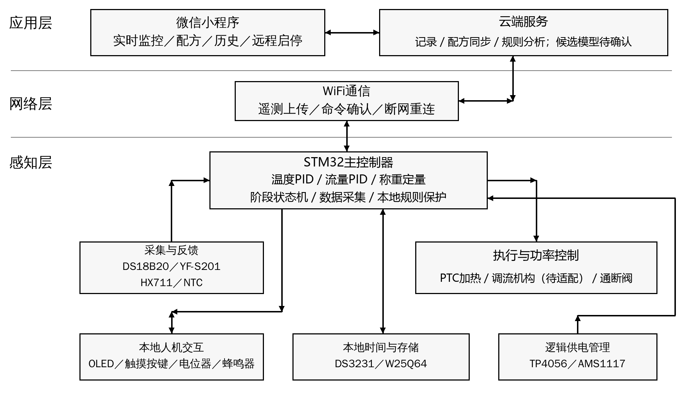

# 莆田学院毕业设计开题报告

| 学生姓名 | 专业 | 学号 |
|---|---|---|
| 待填写 | 物联网工程 | 待填写 |

**设计题目：基于STM32的手冲咖啡温控与定量注水及萃取管理系统设计与实现**

## 一、拟采取的设计方案及可行性分析

（包括主要设计方法和手段，已有的主要设备、软件、资料等说明；本稿于2026年10月10日调整）

### 1、选题的目的和意义

手冲咖啡的冲煮过程涉及水温、注水流量、注水量、咖啡粉质量和时间等参数。已有研究表明，讨论冲煮温度对感官品质的作用时，还需要同时考虑饮料浓度与萃取率，不能将单一温度参数直接等同于咖啡品质[1]。面向咖啡爱好者和小型咖啡馆，本课题不以自动判定口感为目标，而是通过多参数测量、闭环调节和过程记录，降低人工操作差异，为配方对比和重复冲煮提供可量化的依据。

在由温控壶、电子秤和计时工具组成的分散式手冲流程中，操作者需要自行协调温度、流量、粉水比及分段注水时间，过程记录也往往依赖人工。仅控制水温难以同步约束注水流量和总注水量；仅保存配方数值，也难以反映实际执行过程中的变化。因此，本课题针对参数协同不足、配方执行重复性不足、数据分散以及异常不易及时识别等问题，提出温控、定量注水与过程管理相结合的设计方案。

系统以STM32为核心，将温度PID、流量PID、称重反馈定量控制、过程记录、云端配方和微信小程序整合起来。异常检测采用本地规则保护、分阶段残差、MAD/分位数阈值和EWMA。课题贯通传感器应用、嵌入式控制、无线通信和数据管理，体现物联网三层架构；控制性能和异常效果均以实际测试为依据。

### 2、研究的基本内容，拟解决的主要问题

研究内容包括硬件电路与样机制作、STM32嵌入式程序、两路PID与称重定量控制、云端服务及微信小程序。系统拟实现以下功能：

①水温闭环：利用DS18B20采集水温，采用PID算法调节加热输出，并通过NTC记录环境温度，为温度补偿和运行分析提供依据。

②流量闭环：采集经适配和标定的流量信号，采用PID跟踪阶段目标流量，通过可调速泵或已验证的调流机构调节出水。原清单的YF-S201和普通电磁阀先作为候选验证；若不适配，须在任务书冻结前向导师确认替换方案，不以固定通断时序冒充有效流量PID。

③粉水比与称重反馈定量控制：利用HX711及称重传感器测量粉重和注水增重，根据配方计算目标注水量；接近目标时按分段规则降低流量给定，达到目标或补偿关断点后停止出水。不承诺第三个重量PID或重量轨迹跟踪。

④配方与流程管理：保存目标水温、粉水比、阶段注水量、流量和时间等参数，支持预热、闷蒸、分段注水、等待滴滤及完成提醒。

⑤过程记录与配方重复执行：记录水温—时间、流量—时间和重量—时间曲线，保存目标值、实际值和执行状态；重新执行保存的分段水温、流量、阶段注水量及等待时间，并比较重复运行结果。不承诺逐点跟踪历史实际曲线或建立物理数字孪生模型。

⑥本地操作：通过OLED显示水温、流量、重量、计时和工作状态，利用触摸按键及电位器设置参数，通过蜂鸣器完成提示和告警。

⑦云端配方与档案：同步配方、冲煮记录和异常事件，建立用户萃取档案，支持半个月至一个月范围的历史查询；是否必须实际连续采集该时长仍待导师确认，不用生成数据冒充实测。

⑧微信小程序：实现实时数据显示、设备状态查看、配方编辑、远程启停及历史曲线对比，分别展示温度、流量和重量的变化。

⑨异常处理：以阶段规则、分阶段残差、MAD/分位数阈值、EWMA、持续时间/迟滞和参数一致性检查识别已定义的温度、流量及称重异常，保存事件并展示可能原因。本地保护独立执行。

⑩离线运行与安全管理：使用RTC和Flash保存必要的时间、配方与过程数据，断网时仍由设备端完成控制；异常时关闭加热或出水，网络恢复后补传记录。

拟解决的主要问题是：温度PID、流量PID与称重终止如何通过状态机协调；低流量传感器和调流机构是否适配；如何处理关断余水并区分注水量与成品液重；如何在断网时保证本地控制；如何区分正常预热、闷蒸和停水与真正异常。

本课题的特色拟体现在三方面：一是温度与流量两路PID配合称重终止，实现温控和定量注水协同；二是关联保存分段配方、实际曲线和执行状态，提高过程可追溯与重复执行能力；三是形成设备端规则保护、阶段化统计检测与云端事件管理、参数一致性检查的链路。

### 3、研究思路、步骤、方法和措施

首先查阅咖啡冲煮参数、PID控制、STM32外设及异常处理资料[1-3]，建立“应用问题—系统需求—功能模块—验证方法”的对应关系；开展传感器标定和执行器适配，在可测、可控的基础上实现两路PID、称重终止与状态机，随后完成联网和真实测试。异常检测主线采用阶段规则、MAD与EWMA。总体方案如下图所示。

图1 系统总体结构框图

#### （1）系统架构与硬件组成

感知层由STM32完成温度、流量、重量采集及本地控制；网络层通过WiFi连接设备与服务器，拟采用MQTT上传遥测和下发命令，采用HTTPS提供小程序业务接口；应用层完成配方管理、历史查询、可视化和异常分析。实时闭环在STM32本地运行，云端与小程序不直接承担周期性PID运算。STM32具体型号根据外设接口、存储空间和程序规模确定[3]。

保留原始材料列出的15项作为硬件候选清单，不宣称其量程、驱动或高级模块认定已经满足要求。STM32和WiFi另计，最终数量与高级模块口径由导师确认。流量PID需要适配的调流执行器；是否新增或替换为可调速泵须先验证并确认，不以本稿擅自改变最终清单。候选模块用途如下：

①DS18B20：水温采集；②YF-S201：待验证的流量脉冲采集；③HX711：粉重、注水增重及分阶段液重测量；④12V微型电磁阀：通断及终止控制，不默认支持连续调流；⑤12V PTC：待验证功率与安装条件的加热模块。

⑥0.96寸OLED：本地状态显示；⑦TTP223触摸按键×4：模式选择及参数设置；⑧DS3231 RTC：时间与记录授时；⑨W25Q64 Flash：配方与离线数据存储；⑩有源蜂鸣器：完成提醒及异常告警。

⑪NTC热敏电阻：环境温度检测及补偿参考；⑫5V继电器×2：加热与执行器电源通断、运行使能和故障切断；⑬电位器：手动参数调节；⑭TP4056：低功耗逻辑备用电池的充电管理；⑮AMS1117-3.3V：逻辑电路稳压。

样机拟采用洞洞板自行焊接，完成供电、传感器接口及执行器驱动等配套电路，形成可展示个人制作过程的实物。外观围绕加热、注水和称重结构设计，采用纸板结构样件或3D打印外壳，分隔水路、电源和控制电路，并预留检修及散热位置。

#### （2）两路PID与称重反馈定量控制

温度环以目标水温与实测水温的偏差为输入，采用离散PID计算加热输出。PID的基本表达式为u(t)=Kp·e(t)+Ki·∫e(t)dt+Kd·de(t)/dt，实际程序根据采样周期离散化，并加入输出限幅、积分抗饱和和测量滤波[2]。依据加热器及驱动能力选择功率调节方式，机械继电器仅用于低频通断或安全切断，不直接执行高频PWM。

流量环根据标定系数获得实测流量，采用离散PID与阶段目标比较后调节适配的执行器。优先验证可调速泵或其他可调流机构；若使用开关阀时间调制，必须验证测量窗口、动作频率、响应和寿命，不等同于比例阀。停水或测量无效时冻结/复位控制状态，避免无效误差持续积分。

称重定量采用终点与分段规则，不设重量PID外环。根据阶段累计目标与实测增重，在接近目标时降低流量给定，达到目标或提前关断补偿点时关闭出水。温度环设置温度就绪条件，流量PID执行阶段流量目标，状态机负责协调。先分别整定温度与流量环，再验证余水补偿和重复性，不声称三重PID。

明确称重口径：设粉重为mp、目标粉水比为1:r，则目标注水质量为r·mp。将滤杯与接液杯作为整体称重时，增重主要用于反馈累计加水量，不能直接称为成品液重；成品液重拟在滴滤完成后移除滤杯并单独称量接液杯得到。单通道称重采用分阶段测量，流量积分用于交叉校验，实验时考虑滴漏、余水和蒸发等误差。

#### （3）嵌入式软件、云端与小程序

STM32软件拟使用C语言，以定时任务组织采集、两路PID、称重终止、状态机、显示、存储和通信。状态机包括待机、参数确认、预热、闷蒸、分段注水、滴滤等待、完成及故障。配方保存阶段参数和版本号；记录统一采用时间戳、设备编号、会话编号和阶段编号，避免重复计入或调用错误配方。

WiFi通信采用遥测与命令分离的消息结构；远程命令附带命令编号、有效期和设备响应，避免重复或过期命令再次启动。小程序远程启动前要求设备处于已完成本地准备确认的可启动状态，设备端再次检查关键传感器、温度和故障状态，不能将联网等同于允许无人看护加热。断网时维持本地控制与缓存，重新连接后补传，不补执行过期启动命令。

云端拟使用Python构建接口和数据处理服务，通过数据库存储设备、用户、配方、过程采样及异常事件。微信小程序提供实时监控、配方管理、历史档案和异常记录页面，实时曲线与历史曲线分别组织，支持按日期、配方或单次过程查询，并区分下发目标与设备实际反馈。

#### （4）规则与稳健统计异常处理

必做异常处理采用阶段规则、分阶段残差、MAD/分位数阈值、EWMA、持续时间/迟滞与多参数一致性检查。规则仅在相应阶段及数据有效时启用，例如出水命令生效并经过响应宽限期后仍无流量、温度失效或超限、称重严重跳变。云端关联目标残差、EWMA趋势、执行器状态和事件上下文，提供可能原因，不将相关性写成确定故障根因。

异常检测采用阶段规则、分阶段残差、MAD/分位数阈值和EWMA。通过阶段基线、稳健尺度、持续时间判定、迟滞恢复及参数一致性检查，区分传感器硬故障与过程偏离；本地超温、测量失效等保护独立执行，云端负责事件记录和结果展示。

### 4、关键问题及拟采取的解决措施

①传感器适配与测量精度：DS18B20在−10～85℃范围内给出的精度为±0.5℃，不能将该精度直接外推至所有冲煮温度[5]。拟在使用温区对安装后的探头进行多点比对，评估封装滞后和温差。YF-S201常见资料给出的工作流量为1～30L/min[6]，可能与手冲的小流量需求不匹配，故先开展低流量标定及脉冲稳定性实验，并核对实物耐温、材质及食品接触适用性；若不满足控制要求，应在保持课题方向的前提下向导师确认选型调整，不能仅靠软件假定测量有效。

②加热与电源约束：依据水量、PTC实际功率和热损耗估计预热时间并实测，确保12V主电源能够承担加热与阀门负载；5V和3.3V逻辑支路按功耗配置。TP4056与AMS1117不作为12V加热负载的升压或大功率供电方案，备用电池仅考虑逻辑维护与数据保存，并需匹配保护、切换及供电电路。

③称重与执行延迟：通过去皮、标准砝码标定、稳定底座及滤波降低称重噪声；测试阀门关闭延迟和管路余水，在终点控制中设置减速区与提前关断补偿。粉水比按实际注水质量计算，成品液重独立记录，避免混淆两种指标。

④通信与数据一致性：采用本地状态机、Flash缓存、命令确认和时间戳同步，测试断网、重连和重复命令情形；实时采样与通信解耦，避免网络延迟影响控制周期。

⑤异常与用水用电安全：区分本地紧急保护与云端分析，采用阶段规则、MAD/EWMA、持续判定和迟滞降低误报。优先采用信号模拟或限功率、冷水测试，不通过真实干烧等方式制造故障；完成电源防护、线缆固定、防溅水和散热检查后再联调。

### 5、可行性分析与测试方案

技术可行性方面，STM32承担采集、两路PID、称重终止及保护，WiFi承担传输，服务器承担记录与事件分析。PID有公开方法资料[2]；异常检测采用阶段规则、MAD与EWMA。小流量测量、加热能力、调流响应、供电及称重结构须经前期实验验证，不能由模块清单推断性能达标。

软件与资料方面，已具备需求整理稿、导师要求和两份开题格式参考，可查阅器件、控制与开源资料。拟使用STM32开发工具、Python后台、微信开发者工具和数据库。器件、执行器、电源、焊接与校准工具按方案准备，不将未确认设备写成已全部具备。

实施采取“单模块适配—本地控制—网络与配方—异常检测标定—重复测试”的路线，先保证主干稳定再开展综合验证。初试前完成学校要求的开题、范围确认和采购准备，主要制作计划安排在初试后；七天仅为主干冲刺目标，不保证实验、论文和整改全部结束。自行焊接与调试，保留过程照片和测试记录。

测试拟使用参考温度计、计时工具和标准砝码，开展分阶段注水与完整冲煮。固定滤杯、咖啡粉及研磨条件，同条件进行不少于5次重复试验，评估温控误差/超调/稳定时间、流量误差/响应、称重与最终注水量误差、同配方重复性、通信与断网恢复。异常按事件评价检出、误报及延迟，并对MAD/EWMA参数进行标定。重复性不等于口感一致；阈值由标定和导师确认，不写未测试的达标结论。

预期形成可演示的手冲咖啡控制样机、连接图、固件、后台与小程序、配方和历史记录、规则保护及异常检测测试报告，提交论文与归档材料。

### 6、课题研究进度安排

以下为开题通过后的相对教学周安排，具体节点以学院正式通知为准，不沿用往年日期。初试前优先完成规定材料和方案准备，实物制作拟集中在初试后；不以七天冲刺替代完整测试与论文修改。

第1—2周：完成资料检索、需求分析、总体方案和传感器及执行器适配验证，确认关键测量口径、供电方案与测试指标。

第3—4周：完成硬件电路设计、洞洞板焊接、结构初样、单模块测试以及温度、流量和称重标定。

第5—7周：实现状态机、温度PID、流量PID和称重终止，整定参数、余水补偿、基本保护与本地配方，整理测试记录。

第8—10周：完成WiFi通信、云端接口与数据库、微信小程序及历史曲线展示，进行断网缓存和远程命令测试。

第11—12周：完成阶段基线、MAD/EWMA参数标定、安全异常模拟与同配方重复运行测试。

第13—14周：完成系统联调、外观完善和综合测试，形成结果分析与论文初稿，并按导师反馈整改。

第15—16周：完成论文定稿、材料审核、答辩演示准备和代码、数据及实物资料归档。

### 7、主要参考文献

[1] BATALI M E, RISTENPART W D, GUINARD J X. Brew temperature, at fixed brew strength and extraction, has little impact on the sensory profile of drip brew coffee[J]. Scientific Reports, 2020, 10: 16450. DOI:10.1038/s41598-020-73341-4.

[2] ÅSTRÖM K J, HÄGGLUND T. PID Controllers: Theory, Design, and Tuning[M]. 2nd ed. Research Triangle Park: Instrument Society of America, 1995.

[3] STMICROELECTRONICS. STM32F103x8/STM32F103xB: Medium-density performance line Arm-based 32-bit MCU[EB/OL]. [2026-10-03]. [资料来源](https://www.st.com/resource/en/datasheet/stm32f103c8.pdf)

[4] ANALOG DEVICES. DS18B20: Programmable Resolution 1-Wire Digital Thermometer[EB/OL]. [2026-10-03]. [资料来源](https://www.analog.com/media/en/technical-documentation/data-sheets/DS18B20.pdf)

[5] SEEED STUDIO. Water Flow Sensor: YF-S201 specifications and usage[EB/OL]. [2026-10-03]. [资料来源](https://wiki.seeedstudio.com/Water-Flow-Sensor/)

## 二、指导教师意见

（由指导教师填写）

指导教师签名：________________

日期：_______年_____月_____日
