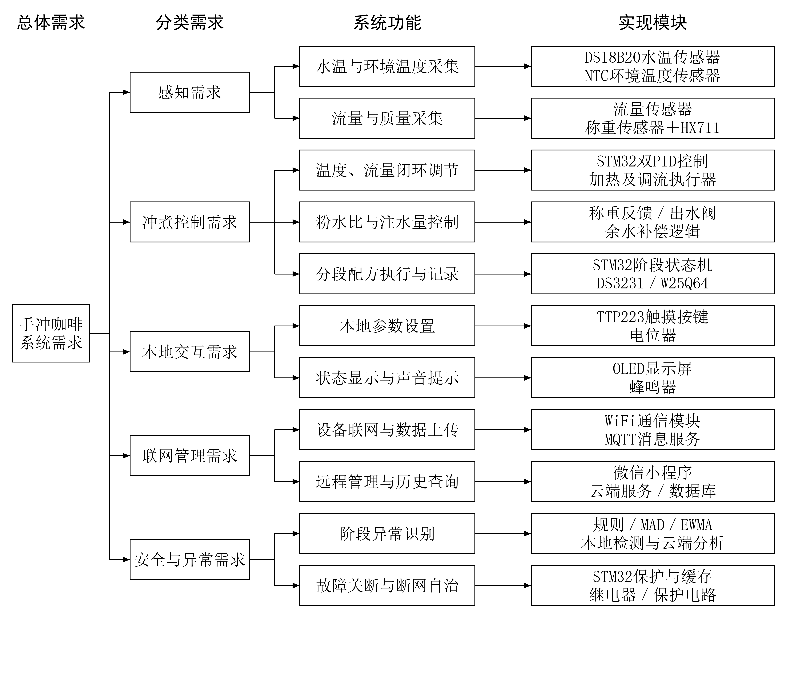
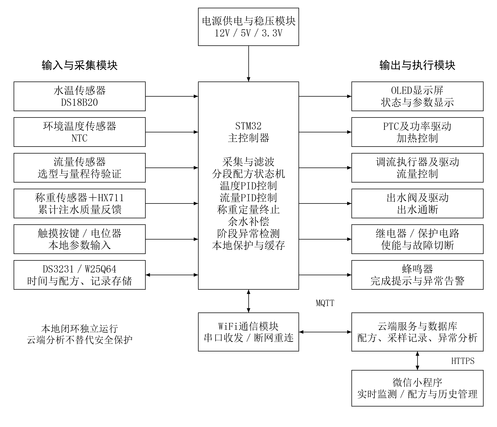

# 莆田学院毕业设计开题报告（精简版）

**设计题目：**基于 STM32 的手冲咖啡温控与定量注水及萃取管理系统设计与实现

> 本版依据 `02_开题报告/参考资料/` 中开题报告模板的常见篇幅与结构，对上一版正文进行压缩；原始报告和“高清配图与创新点”版均保留。

## 一、拟采取的设计方案及可行性分析

### 1、选题的目的和意义

手冲咖啡的冲煮效果受水温、注水流量、注水量、咖啡粉质量和时间等因素共同影响。已有研究指出，评价温度作用时还应结合饮料浓度和萃取率，不能把单一温度直接等同于咖啡品质[1]。本课题不自动判定口感，而是通过测量、控制和记录，为配方对比与重复冲煮提供可量化依据。

现有手冲流程多依靠温控壶、电子秤和计时工具人工配合，参数难以协同约束，过程记录也较分散。课题拟设计基于 STM32 的温控、定量注水与萃取管理系统，改善参数协同、配方执行和过程追溯。

### 2、研究的基本内容，拟解决的主要问题

本课题主要完成硬件样机、STM32 固件、云端服务和微信小程序，拟实现：

1. 温度控制：DS18B20 采集水温，采用 PID 调节加热输出，并通过标定评价控温误差。
2. 流量与定量注水：采集并标定流量信号，跟踪阶段目标流量；结合 HX711 称重反馈控制累计注水质量。
3. 配方与流程管理：保存水温、粉水比、阶段注水量、流量和时间，支持预热、闷蒸、分段注水、滴滤等待和完成提醒。
4. 本地运行与安全保护：显示状态并设置参数；断网时本地控制继续运行，超温或关键测量失效时进入故障态。
5. 云端与小程序：同步配方、冲煮记录和异常事件，提供实时状态、配方编辑、历史曲线和远程操作。
6. 异常处理：按冲煮阶段分析温度、流量和称重偏差，采用规则、MAD/分位数阈值和 EWMA 识别持续异常。

拟解决的问题包括两路 PID 与称重终止的阶段协同、低流量测量和调流机构适配、阀门关闭延迟及余水补偿、断网本地控制，以及正常过程与异常偏离的区分。

### 本课题的创新点

1. **阶段协同控制。**以状态机统一调度温度 PID、流量 PID 和称重终止，称重作为终点约束而非第三个 PID 回路。
2. **配方—执行关联。**按会话和阶段保存配方版本、目标值、实测值及执行状态，支持历史追溯和同配方重复执行。
3. **分层异常处理。**设备端完成安全联锁，云端按阶段窗口进行 MAD/EWMA 分析，降低正常过渡过程被误报的风险。

以上创新点属于工程组织与系统集成设计，不宣称提出新的 PID 或统计检测算法；有效性通过样机测试验证。

### 3、研究思路、步骤、方法和措施

先查阅咖啡冲煮、PID 控制、STM32 外设和异常检测资料，完成需求、功能、模块与验证方法的对应关系；再按“器件适配—本地控制—联网管理—重复测试”的顺序实施。需求—功能—模块关系见图1，系统总体架构见图2。

系统分为感知与控制层、网络层和应用层。STM32 完成采集、两路 PID、称重终止和本地保护；WiFi 及 MQTT 传输遥测与命令；云端、数据库和微信小程序完成配方管理、历史查询与可视化。候选器件以适配和标定结果为准。

温度环采用离散 PID，流量环跟踪阶段目标；称重采用去皮、滤波、分段目标和提前关断补偿，不设置重量 PID 外环。固件实现采集、控制、显示、存储和通信；云端保存设备、用户、配方、采样及异常事件。

### 4、关键问题及解决措施

在实际温区和流量范围内进行传感器与执行器标定，不把器件标称参数直接写成系统性能；使用标准砝码、稳定底座和滤波降低称重噪声，实测关阀延迟与管路余水；采用本地状态机、Flash 缓存、时间戳、命令确认和阶段窗口，分别验证断网恢复、重复命令、正常过渡和模拟异常。

### 5、可行性分析与测试方案

STM32 可承担采集、两路 PID、称重终止和保护，WiFi 承担数据传输，服务器承担记录与事件分析；相关控制和统计方法有公开资料支持[2,6-7]。流量、加热、称重和供电能力仍需通过前期实验确认。实施时先完成单模块标定，再进行本地闭环、网络联调和综合测试。

固定滤杯、咖啡粉质量和研磨条件，同一配方进行不少于 5 次重复试验，记录温度稳态偏差、流量偏差、最终注水质量偏差和重复性；异常检测使用独立数据，报告检出率、误报次数和在线检出延迟。预期形成控制样机、固件、后台、小程序、配方记录及测试报告。

### 6、课题研究进度安排

- 第1—4周：完成资料检索、需求分析、总体方案、硬件制作及传感器与执行器标定。
- 第5—8周：完成状态机、温度 PID、流量 PID、称重终止、本地配方和安全保护。
- 第9—12周：完成 WiFi、云端接口、数据库和微信小程序，进行记录、断网恢复和远程命令测试。
- 第13—16周：完成异常检测标定、重复试验、系统联调、论文撰写、答辩准备及资料归档。

### 7、主要参考文献

[1] BATALI M E, RISTENPART W D, GUINARD J X. *Brew temperature, at fixed brew strength and extraction, has little impact on the sensory profile of drip brew coffee*[J]. Scientific Reports, 2020, 10:16450.

[2] ÅSTRÖM K J, HÄGGLUND T. *PID Controllers: Theory, Design, and Tuning*[M]. 2nd ed. Research Triangle Park: Instrument Society of America, 1995.

[3] STMICROELECTRONICS. *STM32F103x8/STM32F103xB: Medium-density performance line Arm-based 32-bit MCU*[EB/OL]. [2026-10-10].

[4] ANALOG DEVICES. *DS18B20: Programmable Resolution 1-Wire Digital Thermometer*[EB/OL]. [2026-10-10].

[5] SEEED STUDIO. *Water Flow Sensor*[EB/OL]. [2026-10-10].

[6] NATIONAL INSTITUTE OF STANDARDS AND TECHNOLOGY. *Measures of Scale*[EB/OL]. [2026-10-10].

[7] NATIONAL INSTITUTE OF STANDARDS AND TECHNOLOGY. *EWMA Control Charts*[EB/OL]. [2026-10-10].
