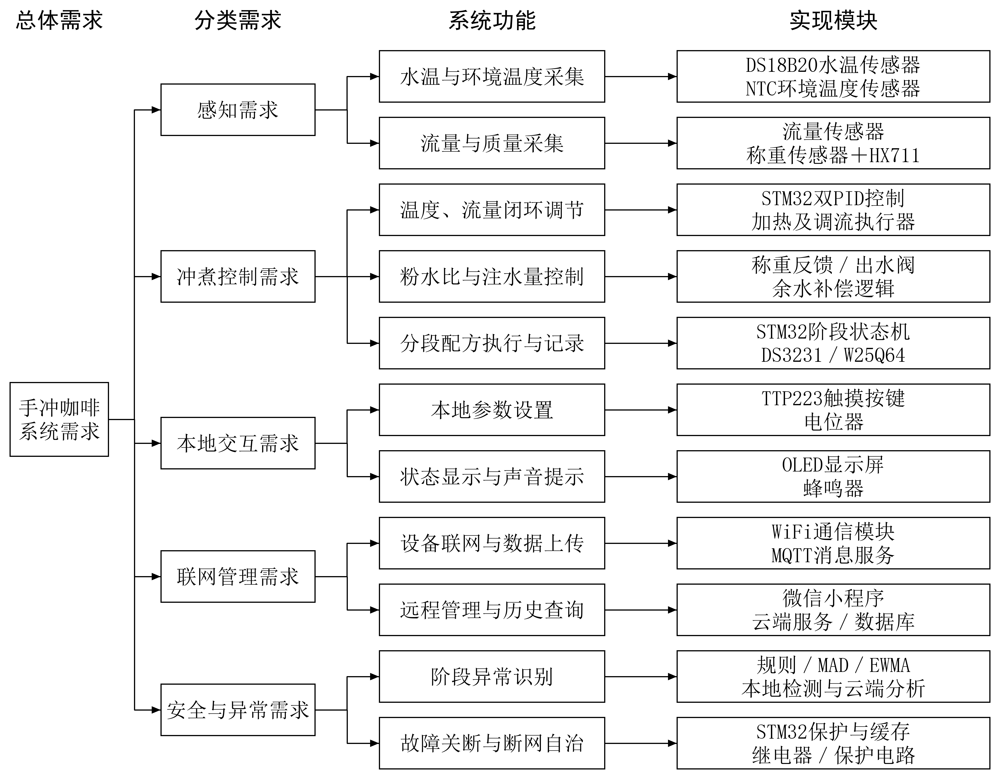
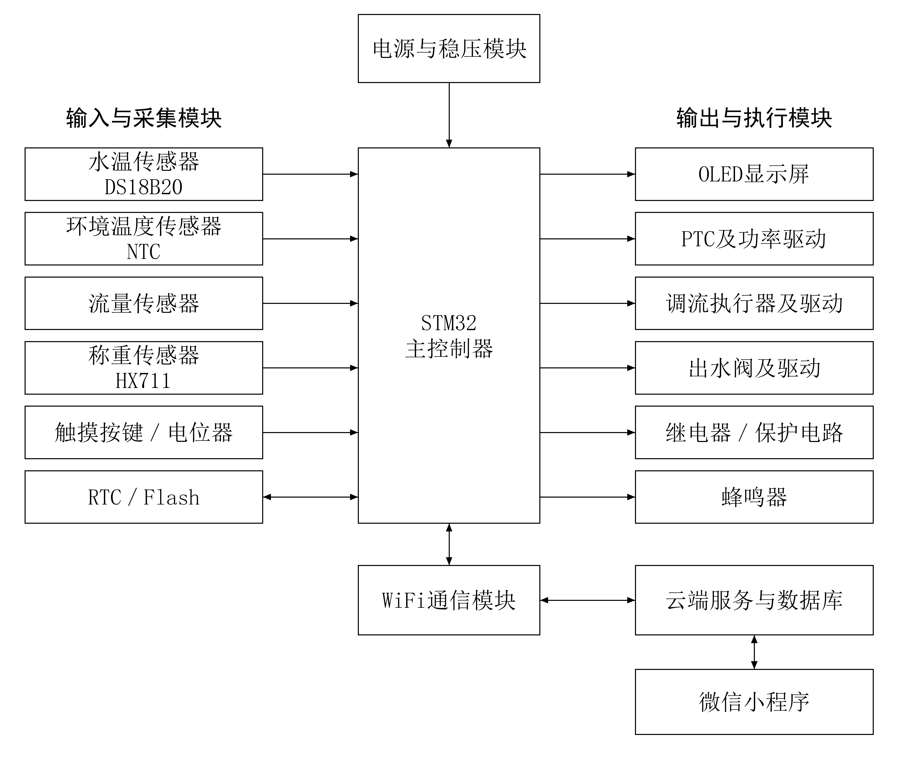

# 手冲咖啡毕业设计开题报告（精简版，2026-10-10 v3，格式修正版）

莆田学院毕业设计开题报告

学生姓名

________

专业

物联网工程

学号

____________

设计题目

基于STM32的手冲咖啡温控与定量注水及萃取管理系统设计与实现

一、拟采取的设计方案及可行性分析（包括主要设计方法和手段，已有的主要设备、软件、资料等说明）

1、选题的目的和意义

手冲咖啡的冲煮效果受水温、注水流量、注水量、咖啡粉质量和时间等因素共同影响。已有研究指出，评价温度作用时还应结合饮料浓度和萃取率，不能把单一温度直接等同于咖啡品质[1]。本课题不自动判定口感，而是通过测量、控制和记录，为配方对比与重复冲煮提供可量化依据。

现有手冲流程多依靠温控壶、电子秤和计时工具人工配合，温度、流量和总注水量难以协同约束，过程记录也较分散。为此，课题拟设计基于STM32的温控、定量注水与萃取管理系统，改善参数协同、配方执行和过程追溯。

系统以STM32为核心，结合温度与流量闭环、称重反馈、无线通信、云端记录和微信小程序；实时控制与安全保护在设备端完成，云端主要负责配方、历史数据和异常事件管理。

2、研究的基本内容，拟解决的主要问题

本课题主要完成硬件样机、STM32固件、云端服务和微信小程序，拟实现以下功能：

①温度控制：DS18B20采集水温，采用PID调节加热输出，并通过标定评价控温误差。

②流量与定量注水：采集并标定流量信号，跟踪阶段目标流量；结合HX711称重反馈控制累计注水质量，接近目标时减流并在补偿关断点停止出水。

③配方与流程管理：保存水温、粉水比、阶段注水量、流量和时间，支持预热、闷蒸、分段注水、滴滤等待和完成提醒。

④本地运行与安全保护：通过OLED显示状态，使用按键设置参数；断网时本地状态机和保护逻辑继续运行，超温或关键测量失效时进入故障态。

⑤云端与小程序：同步配方、冲煮记录和异常事件，提供实时状态、配方编辑、历史曲线和远程操作；远程命令设置编号、有效期和确认机制。

⑥异常处理：按冲煮阶段分析温度、流量和称重偏差，采用规则、MAD/分位数阈值和EWMA识别持续异常，并区分实时保护与断网后的离线复核。

拟解决的主要问题包括：两路PID与称重终止的阶段协同；低流量测量和调流机构的适配；阀门关闭延迟及管路余水补偿；断网条件下的本地控制；以及正常预热、闷蒸、停水和异常偏离的区分。

本课题的创新点

①阶段协同控制：以状态机统一调度温度PID、流量PID和称重终止，称重作为终点约束而非第三个PID回路。

②配方—执行关联：按会话和阶段保存配方版本、目标值、实测值及执行状态，使历史记录可追溯并支持同配方重复执行。

③分层异常处理：设备端独立完成安全联锁，云端按阶段窗口进行MAD/EWMA分析，降低把正常过渡过程误报为异常的风险。

以上创新点属于工程组织与系统集成设计，不宣称提出新的PID或统计检测算法；有效性通过样机测试验证。

3、研究思路、步骤、方法和措施

先查阅咖啡冲煮、PID控制、STM32外设和异常检测资料，完成需求、功能、模块与验证方法的对应关系；再按“器件适配—本地控制—联网管理—重复测试”的顺序实施。需求—功能—模块关系见图1，系统总体架构见图2。

图1 需求—功能—模块图

图2 系统总体架构图

（1）系统架构与硬件组成

系统分为感知与控制层、网络层和应用层。STM32完成温度、流量、重量采集、两路PID、称重终止和本地保护；WiFi及MQTT传输遥测与命令；云端、数据库和微信小程序完成配方管理、历史查询与可视化。候选器件包括DS18B20、流量传感器、称重传感器与HX711、加热器、出水执行器、OLED、RTC、Flash及蜂鸣器，具体选型以适配和标定结果为准。

样机采用洞洞板完成供电、传感器接口和执行器驱动，围绕加热、注水和称重结构制作外壳，分隔水路、电源与控制电路，并保留散热和检修位置。

（2）控制与数据管理方法

温度环采用离散PID调节加热输出，流量环根据标定信号跟踪阶段目标；称重采用去皮、滤波、分段目标和提前关断补偿，不设置重量PID外环。状态机覆盖待机、预热、闷蒸、分段注水、滴滤等待、完成和故障等状态。

固件以C语言实现采集、控制、显示、存储和通信；云端拟用Python和数据库保存设备、用户、配方、采样及异常事件；微信小程序提供实时监控、配方编辑和历史查询。异常统计参数由标定数据确定，断网补传数据单独作为离线复核。

4、关键问题及解决措施

①传感器与执行器：在实际温区和流量范围内进行多点比对、脉冲标定和响应测试，不把器件标称参数直接写成系统性能。

②称重与安全：使用标准砝码、稳定底座和滤波降低噪声，实测关阀延迟与管路余水；完成供电、防溅水、散热和独立过温切断检查后再进行热水联调。

③通信与异常：采用本地状态机、Flash缓存、时间戳、命令确认和阶段窗口，分别验证断网恢复、重复命令、正常过渡和模拟异常。

5、可行性分析与测试方案

技术上，STM32可承担采集、两路PID、称重终止和保护，WiFi承担数据传输，服务器承担记录与事件分析；相关控制和统计方法有公开资料支持[2,6-7]。流量、加热、称重和供电能力仍需通过前期实验确认。

软件与资料方面，已有导师要求、需求整理稿和开题格式参考，可使用STM32开发工具、Python、微信开发者工具及数据库。实施时先完成单模块标定，再进行本地闭环、网络联调和综合测试。

测试固定滤杯、咖啡粉质量和研磨条件，同一配方进行不少于5次重复试验，记录温度稳态偏差、流量偏差、最终注水质量偏差和重复性；异常检测使用独立数据，报告检出率、误报次数和在线检出延迟。预期形成控制样机、固件、后台、小程序、配方记录及测试报告。

6、课题研究进度安排

第1—4周：完成资料检索、需求分析、总体方案、硬件制作及传感器与执行器标定。

第5—8周：完成状态机、温度PID、流量PID、称重终止、本地配方和安全保护，开展控制测试。

第9—12周：完成WiFi、云端接口、数据库和微信小程序，进行历史记录、断网恢复和远程命令测试。

第13—16周：完成异常检测标定、重复试验、系统联调、论文撰写、答辩准备及资料归档。

7、主要参考文献

[1] BATALI M E, RISTENPART W D, GUINARD J X. Brew temperature, at fixed brew strength and extraction, has little impact on the sensory profile of drip brew coffee[J]. Scientific Reports, 2020, 10:16450. DOI:10.1038/s41598-020-73341-4.

[2] ÅSTRÖM K J, HÄGGLUND T. PID Controllers: Theory, Design, and Tuning[M]. 2nd ed. Research Triangle Park: Instrument Society of America, 1995.

[3] STMICROELECTRONICS. STM32F103x8/STM32F103xB: Medium-density performance line Arm-based 32-bit MCU[EB/OL]. [2026-10-10].

[4] ANALOG DEVICES. DS18B20: Programmable Resolution 1-Wire Digital Thermometer[EB/OL]. [2026-10-10].

[5] SEEED STUDIO. Water Flow Sensor[EB/OL]. [2026-10-10].

[6] NATIONAL INSTITUTE OF STANDARDS AND TECHNOLOGY. Measures of Scale[EB/OL]. [2026-10-10].

[7] NATIONAL INSTITUTE OF STANDARDS AND TECHNOLOGY. EWMA Control Charts[EB/OL]. [2026-10-10].

二、指导教师意见

指导教师签名：________________

_______年_____月_____日
