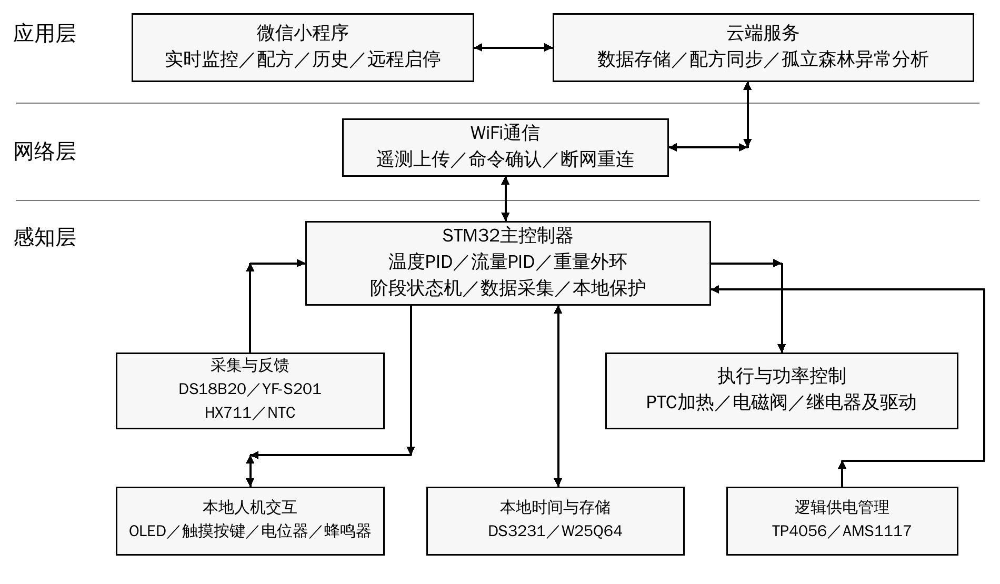

# 莆田学院毕业设计开题报告

| 学生姓名 | 专业 | 学号 |
|---|---|---|
| 待填写 | 物联网工程 | 待填写 |

**设计题目：基于STM32的手冲咖啡多参数PID闭环控制与萃取管理系统设计与实现**

## 一、拟采取的设计方案及可行性分析

（包括主要设计方法和手段，已有的主要设备、软件、资料等说明）

### 1、选题的目的和意义

手冲咖啡的冲煮过程涉及水温、注水流量、注水量、咖啡粉质量和时间等参数。已有研究表明，讨论冲煮温度对感官品质的作用时，还需要同时考虑饮料浓度与萃取率，不能将单一温度参数直接等同于咖啡品质[1]。面向咖啡爱好者和小型咖啡馆，本课题不以自动判定口感为目标，而是通过多参数测量、闭环调节和过程记录，降低人工操作差异，为配方对比和重复冲煮提供可量化的依据。

在由温控壶、电子秤和计时工具组成的分散式手冲流程中，操作者需要自行协调温度、流量、粉水比及分段注水时间，过程记录也往往依赖人工。仅控制水温难以同步约束注水流量和总注水量；仅保存配方数值，也难以反映实际执行过程中的变化。因此，本课题针对参数协同不足、过程难以复刻、数据分散以及异常不易及时识别等问题，提出多参数闭环控制与萃取管理相结合的设计方案。

系统以STM32为核心，将水温控制、流量控制、称重反馈、曲线记录、云端配方和微信小程序整合起来，并在云端引入孤立森林算法辅助识别设备及冲煮过程异常。课题将传感器应用、嵌入式控制、无线通信、数据管理和机器学习方法贯通，体现物联网感知层、网络层和应用层的协同，具有明确的工程实践意义。

### 2、研究的基本内容，拟解决的主要问题

研究内容包括硬件电路与样机制作、STM32嵌入式程序、三重闭环控制算法、云端服务及微信小程序。系统拟实现以下功能：

①水温闭环：利用DS18B20采集水温，采用PID算法调节加热输出，并通过NTC记录环境温度，为温度补偿和运行分析提供依据。

②流量闭环：采集YF-S201脉冲信号，经标定换算流量，根据目标注水曲线调节电磁阀的通断时间，研究流量误差修正和分段注水控制。

③粉水比与称重闭环：利用HX711及称重传感器测量粉重和注水增重，根据配方计算目标注水量，以重量反馈修正流量给定并完成终点控制。

④配方与流程管理：保存目标水温、粉水比、阶段注水量、流量和时间等参数，支持预热、闷蒸、分段注水、等待滴滤及完成提醒。

⑤曲线记录与复刻：记录水温—时间、流量—时间和重量—时间曲线，保存目标值、实际值及执行状态；复刻时依据历史目标轨迹重新闭环执行，而非直接重放阀门通断命令。

⑥本地操作：通过OLED显示水温、流量、重量、计时和工作状态，利用触摸按键及电位器设置参数，通过蜂鸣器完成提示和告警。

⑦云端配方与档案：同步配方、冲煮记录和异常事件，建立用户萃取档案，支持至少半个月至一个月的历史数据查询。

⑧微信小程序：实现实时数据显示、设备状态查看、配方编辑、远程启停及历史曲线对比，分别展示温度、流量和重量的变化。

⑨异常检测：在云端对多参数时间窗口进行特征提取和孤立森林评分，结合规则提示温度、流量、称重或过程偏离异常；设备端保留独立的基础保护。

⑩离线运行与安全管理：使用RTC和Flash保存必要的时间、配方与过程数据，断网时仍由设备端完成控制；异常时关闭加热或出水，网络恢复后补传记录。

拟解决的主要问题是：温度、流量和称重三个环路共用执行过程时如何协同；低流量条件下流量测量和电磁阀调节是否满足需求；如何区分注水量与成品液重；如何在网络不稳定时保证本地控制；如何避免将正常的预热、闷蒸和停水阶段误判为异常。

本课题的特色拟体现在三方面：一是温度环与流量—重量级联环协同，实现从单参数调节向过程控制拓展；二是将配方目标、实际曲线和执行状态关联保存，提高过程可追溯和复刻能力；三是形成“设备端规则保护＋云端多参数异常分析”的协同机制。上述内容作为工程设计特色，通过对比实验检验，不预先宣称算法原创性或已达到的性能。

### 3、研究思路、步骤、方法和措施

首先查阅咖啡冲煮参数、PID控制、STM32外设以及异常检测方面的资料[1-4]，建立“应用问题—系统需求—功能模块—验证方法”的对应关系；随后开展传感器标定和执行器适配实验，在可测、可控的基础上完成硬件与软件设计，最后进行系统联调和测试。总体方案如下图所示。

图1 系统总体结构框图

#### （1）系统架构与硬件组成

感知层由STM32完成温度、流量、重量采集及本地控制；网络层通过WiFi连接设备与服务器，拟采用MQTT上传遥测和下发命令，采用HTTPS提供小程序业务接口；应用层完成配方管理、历史查询、可视化和异常分析。实时闭环在STM32本地运行，云端与小程序不直接承担周期性PID运算。STM32具体型号根据外设接口、存储空间和程序规模确定[4]。

保留需求整理稿列出的15个硬件功能模块，另设STM32主控与WiFi通信模块，各模块用途如下：

①DS18B20：水温采集；②YF-S201：流量脉冲采集；③HX711：连接称重传感器，完成粉重、注水增重及分阶段液重测量；④12V微型电磁阀：出水控制；⑤12V PTC加热模块：水温调节。

⑥0.96寸OLED：本地状态显示；⑦TTP223触摸按键×4：模式选择及参数设置；⑧DS3231 RTC：时间与记录授时；⑨W25Q64 Flash：配方与离线数据存储；⑩有源蜂鸣器：完成提醒及异常告警。

⑪NTC热敏电阻：环境温度检测及补偿参考；⑫5V继电器×2：加热与执行器电源通断、运行使能和故障切断；⑬电位器：手动参数调节；⑭TP4056：低功耗逻辑备用电池的充电管理；⑮AMS1117-3.3V：逻辑电路稳压。

样机拟采用洞洞板自行焊接，完成供电、传感器接口及执行器驱动等配套电路，形成可展示个人制作过程的实物。外观围绕加热、注水和称重结构设计，采用纸板结构样件或3D打印外壳，分隔水路、电源和控制电路，并预留检修及散热位置。

#### （2）多参数PID闭环设计

温度环以目标水温与实测水温的偏差为输入，采用离散PID计算加热输出。PID的基本表达式为u(t)=Kp·e(t)+Ki·∫e(t)dt+Kd·de(t)/dt，实际程序根据采样周期离散化，并加入输出限幅、积分抗饱和和测量滤波[2]。依据加热器及驱动能力选择功率调节方式，机械继电器仅用于低频通断或安全切断，不直接执行高频PWM。

流量环根据传感器计数和标定系数获得实测流量，与阶段目标流量比较后调整出水。由于普通电磁阀为开关执行器，拟在验证其允许动作频率和寿命的基础上采用合适的时间窗口调制，不将其等同于可连续调节开度的比例阀。对停水、恢复出水和计数不足的窗口设置专门处理，避免无效误差导致积分累积。

重量环采用较慢的外环，以阶段目标累计注水质量与实测增重之差计算流量修正值，流量内环执行修正后的目标；接近目标时减小注水速度，达到终点后关闭电磁阀。温度环独立调节并对注水流程设置温度就绪条件，构成三重闭环协同，而不是三个PID直接竞争同一阀门。通过先内环、后外环的调试顺序确定参数，并与单温控、固定阀门时序方案比较。

明确称重口径：设粉重为mp、目标粉水比为1:r，则目标注水质量为r·mp。将滤杯与接液杯作为整体称重时，增重主要用于反馈累计加水量，不能直接称为成品液重；成品液重拟在滴滤完成后移除滤杯并单独称量接液杯得到。单通道称重采用分阶段测量，流量积分用于交叉校验，实验时考虑滴漏、余水和蒸发等误差。

#### （3）嵌入式软件、云端与小程序

STM32软件拟使用C语言开发，以定时任务组织数据采集、闭环运算、状态机、显示、存储和通信。状态机划分为待机、参数确认、预热、闷蒸、分段注水、滴滤等待、完成及故障状态。配方以阶段参数和版本号保存，过程数据统一使用时间戳、设备编号、会话编号和阶段编号，防止记录串联或复刻时调用错误版本。

WiFi通信采用遥测与命令分离的消息结构；远程命令附带命令编号、有效期和设备响应，避免重复或过期命令再次启动。小程序远程启动前要求设备处于已完成本地准备确认的可启动状态，设备端再次检查关键传感器、温度和故障状态，不能将联网等同于允许无人看护加热。断网时维持本地控制与缓存，重新连接后补传，不补执行过期启动命令。

云端拟使用Python构建接口和数据处理服务，通过数据库存储设备、用户、配方、过程采样及异常事件。微信小程序提供实时监控、配方管理、历史档案和异常记录页面，实时曲线与历史曲线分别组织，支持按日期、配方或单次过程查询，并区分下发目标与设备实际反馈。

#### （4）孤立森林异常检测方法

采用Isolation Forest作为云端异常分析方法，其基本思想是利用随机划分使异常样本较早被孤立[3]。采集水温、温差、温度变化率、流量及偏差、重量变化率、阀门状态和加热状态等特征；按预热、闷蒸及注水阶段组织数据，对缺失值、瞬时跳变和时间对齐进行处理，避免正常阶段变化造成误报。

利用正常运行数据拟合模型，以独立运行会话划分训练、阈值标定及测试数据，避免同一次过程的相邻窗口同时进入训练与测试。通过可控的流量受限、传感器断连模拟、称重扰动等方式构造测试情形。模型输出只表示异常程度，异常类别由“异常评分＋状态规则”给出提示，不能直接推断故障根因。

若采用scikit-learn实现，需注意其score_samples值越低越异常，且不直接等同于需求整理稿所示的0～1异常分数[7]。展示端可在验证数据上统一分值方向并建立归一化映射，使用实验确定的阈值分级记录和告警。模型不承担实时紧急保护，设备端对超温、测量失效和长时间无流量等状态独立采取关闭加热或出水措施。

### 4、关键问题及拟采取的解决措施

①传感器适配与测量精度：DS18B20在−10～85℃范围内给出的精度为±0.5℃，不能将该精度直接外推至所有冲煮温度[5]。拟在使用温区对安装后的探头进行多点比对，评估封装滞后和温差。YF-S201常见资料给出的工作流量为1～30L/min[6]，可能与手冲的小流量需求不匹配，故先开展低流量标定及脉冲稳定性实验，并核对实物耐温、材质及食品接触适用性；若不满足控制要求，应在保持课题方向的前提下向导师确认选型调整，不能仅靠软件假定测量有效。

②加热与电源约束：依据水量、PTC实际功率和热损耗估计预热时间并实测，确保12V主电源能够承担加热与阀门负载；5V和3.3V逻辑支路按功耗配置。TP4056与AMS1117不作为12V加热负载的升压或大功率供电方案，备用电池仅考虑逻辑维护与数据保存，并需匹配保护、切换及供电电路。

③称重与执行延迟：通过去皮、标准砝码标定、稳定底座及滤波降低称重噪声；测试阀门关闭延迟和管路余水，在终点控制中设置减速区与提前关断补偿。粉水比按实际注水质量计算，成品液重独立记录，避免混淆两种指标。

④通信与数据一致性：采用本地状态机、Flash缓存、命令确认和时间戳同步，测试断网、重连和重复命令情形；实时采样与通信解耦，避免网络延迟影响控制周期。

⑤异常与用水用电安全：区分设备端紧急保护和云端分析告警，通过规则与模型交叉验证降低误报。对危险情形优先进行信号模拟或限功率实验，不通过真实干烧等方式制造测试故障；完成电源防护、线缆固定、防溅水和散热检查后再进行联调。

### 5、可行性分析与测试方案

技术可行性方面，STM32能够承担传感器接口、定时任务及控制运算，WiFi承担网络传输，服务器承担历史管理与模型分析，职责划分有利于减少嵌入式端资源压力。PID控制和孤立森林均有公开方法资料可供学习与实现[2-4]。不过，小流量测量、PTC升温能力、电磁阀动作响应及称重结构均须以前期实验结果为依据，不能仅由模块清单判断系统已经满足性能要求。

软件与资料方面，已具备课题需求整理稿、导师要求整理内容以及两份开题报告格式参考，并可查阅控制方法、主控和传感器资料。拟使用STM32开发工具、Python及scikit-learn、微信开发者工具和数据库软件。所需开发板、传感器、执行器、电源、焊接工具和校准器具按设计采购或借用；现阶段不将这些设备表述为已经全部具备。

实施可行性方面，采取“单模块验证—本地控制—网络联调—算法扩展—完整样机”的分步路线。优先完成水温、流量、称重和基本保护，再完善配方记录、小程序与异常分析。样机制作坚持自行焊接与调试，保留电路图、测试记录和实物过程照片，以保证成果可检查、问题可追踪。

测试拟使用参考温度计、计时工具及标准砝码，开展空载、带水、分阶段注水和完整冲煮实验。固定滤杯、咖啡粉及研磨条件，同一条件进行不少于5次重复试验，并设置不同温度、注水量和流量目标；曲线复刻一致性不直接等同于感官品质一致性。拟评价：温控稳态误差、超调及稳定时间；流量误差、低流量可测性与响应时间；称重误差及最终注水量偏差；同配方曲线偏差和重复性；命令成功率、时延及断网恢复；异常检测准确性、误报率和检出时延。具体验收阈值经标定和导师确认后确定，开题阶段不填写未经测试的达标结果。

预期形成一套可演示的手冲咖啡控制样机，完成硬件连接图、嵌入式程序、云端与小程序代码、配方及历史数据管理、异常检测实验和测试报告，并提交毕业设计论文及相关归档材料。

### 6、课题研究进度安排

以下以开题通过后的教学周编排，实际起止日期按学院毕业设计安排调整，不沿用参考报告中的往年日期。

第1—2周：完成资料检索、需求分析、总体方案和传感器及执行器适配验证，确认关键测量口径、供电方案与测试指标。

第3—4周：完成硬件电路设计、洞洞板焊接、结构初样、单模块测试以及温度、流量和称重标定。

第5—7周：实现状态机和三重闭环控制，完成参数整定、基本保护、配方存储及本地显示，整理阶段测试记录。

第8—10周：完成WiFi通信、云端接口与数据库、微信小程序及历史曲线展示，进行断网缓存和远程命令测试。

第11—12周：采集正常运行数据，完成孤立森林训练、阈值标定及模拟异常测试，开展配方复刻对比实验。

第13—14周：完成系统联调、外观完善和综合测试，形成结果分析与论文初稿，并按导师反馈整改。

第15—16周：完成论文定稿、材料审核、答辩演示准备和代码、数据及实物资料归档。

### 7、主要参考文献

[1] BATALI M E, RISTENPART W D, GUINARD J X. Brew temperature, at fixed brew strength and extraction, has little impact on the sensory profile of drip brew coffee[J]. Scientific Reports, 2020, 10: 16450. DOI:10.1038/s41598-020-73341-4.

[2] ÅSTRÖM K J, HÄGGLUND T. PID Controllers: Theory, Design, and Tuning[M]. 2nd ed. Research Triangle Park: Instrument Society of America, 1995.

[3] LIU F T, TING K M, ZHOU Z H. Isolation Forest[C]//2008 Eighth IEEE International Conference on Data Mining. IEEE, 2008: 413-422. DOI:10.1109/ICDM.2008.17.

[4] STMICROELECTRONICS. STM32F103x8/STM32F103xB: Medium-density performance line Arm-based 32-bit MCU[EB/OL]. [2026-10-03]. [资料来源](https://www.st.com/resource/en/datasheet/stm32f103c8.pdf)

[5] ANALOG DEVICES. DS18B20: Programmable Resolution 1-Wire Digital Thermometer[EB/OL]. [2026-10-03]. [资料来源](https://www.analog.com/media/en/technical-documentation/data-sheets/DS18B20.pdf)

[6] SEEED STUDIO. Water Flow Sensor: YF-S201 specifications and usage[EB/OL]. [2026-10-03]. [资料来源](https://wiki.seeedstudio.com/Water-Flow-Sensor/)

[7] SCIKIT-LEARN DEVELOPERS. sklearn.ensemble.IsolationForest[EB/OL]. [2026-10-03]. [资料来源](https://scikit-learn.org/stable/modules/generated/sklearn.ensemble.IsolationForest.html)

## 二、指导教师意见

（由指导教师填写）

指导教师签名：________________

日期：_______年_____月_____日
